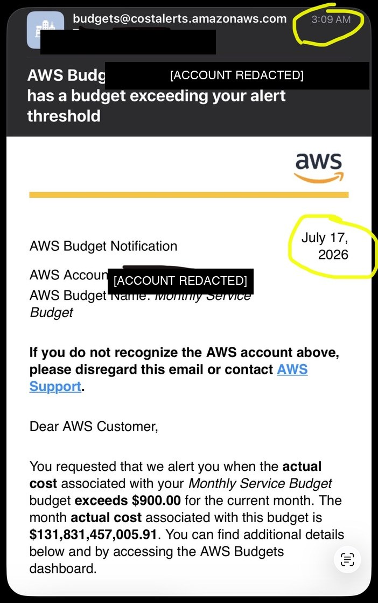

# Kronos

> *Κρόνος was the Titan who devoured his own children so that only what was truly integral would survive the reckoning. The children that returned from his belly ruled. The ones that didn't were never meant to.*

**A claim-centric assurance control plane that continuously reconciles system claims against observed reality and executes bounded, authorized challenges to determine which claims survive — under what conditions, with what coverage, confidence, and freshness.**

Kronos is a universal adversarial assurance platform. It is a discipline for proving that software is safe to run — through structured, authorized, evidence-preserving attempts to break it. It works on any target system, in any language, on any runtime, at any deployment surface. **Kronos does not certify that software is safe. It makes assurance claims testable, challengeable, and auditable.**

[](LICENSE) [](https://beta.olympus-grid.com/kronos) [](methodology/claims/) [](#status)

---

> ⚠️ **THIS REPOSITORY IS A PUBLIC FRAMEWORK TEMPLATE, NOT AN ENGAGEMENT WORKSPACE.**
>
> This repo ships the Kronos methodology, tools, templates, reference documentation, and the Reckonings blog. It is **public** and **AGPL-3.0**. **Real engagement content — target-org identifiers, individuals under test, incident narratives, per-attack matrices for real clients, extracted data — must NOT be committed here.**
>
> Engagements live in adopter repos: the client's own repo, a private operator-owned repo, or a local operator workspace. See [`SECURITY.md`](SECURITY.md) for the isolation policy, [`CLAUDE.md`](CLAUDE.md) for operator-agent guidance, and [Install](#install-adopter-pattern) below for the copy-into-adopter-repo adoption pattern.

---

<p align="center">
  
</p>

<p align="center"><em>2026-07-17, 3:09 AM.<br/>The moment Kronos was named.</em></p>

The full story of why this bill was never real, why an empty AWS account cannot generate 120 petabytes of NAT-gateway traffic per day, and why that impossibility is the load-bearing insight of Kronos: [`docs/inception/00-founding-incident.md`](docs/inception/00-founding-incident.md).

---

## Table of contents

- [What Kronos is](#what-kronos-is)
- [Why Kronos is not only a security tool](#why-kronos-is-not-only-a-security-tool)
- [The three qualities that make Kronos not just another scanner](#the-three-qualities-that-make-kronos-not-just-another-scanner)
- [Reckonings — the public writing of Kronos](#reckonings--the-public-writing-of-kronos)
- [Black October — the first week of the claim set](#black-october--the-first-week-of-the-claim-set)
- [The self-disclosure rule — the trust claim](#the-self-disclosure-rule--the-trust-claim)
- [The dialectic with EOS](#the-dialectic-with-eos)
- [Reading paths](#reading-paths)
- [What this repository contains](#what-this-repository-contains)
- [What this repository does NOT contain — and must never contain](#what-this-repository-does-not-contain--and-must-never-contain)
- [Install (adopter pattern)](#install-adopter-pattern)
- [Ethics gate](#ethics-gate)
- [The reference viewer](#the-reference-viewer)
- [Novel properties + IP posture](#novel-properties--ip-posture)
- [Status](#status)
- [License](#license)
- [Name](#name)

---

## What Kronos is

Kronos is a discipline for proving that software is safe to run — through structured, authorized, evidence-preserving attempts to break it. It works on any target system, in any language, on any runtime, at any deployment surface. A project adopts Kronos by copying a small folder tree into its repository and running the discipline:

- Every meaningful adversarial evaluation of a system is one **engagement**.
- An engagement lives in a single markdown document that travels through a kanban of folders: `00_scope/` → `01_authorized/` → `02_planning/` → `03_ready/` → `04_running/` → `05_evidence/` → `06_shipped/`, with `07_aborted/` for engagements that never close.
- The document has two halves: a **governance half** (target boundary, authorization artifact, rules of engagement) authored by the human approver, and an **execution half** (target model, attack matrix, oracles, evidence, findings, scorecard delta) authored by the AI operator-agent.
- The engagement **closes** only when every planned attack has run, every oracle has evaluated, every finding has been written, and the scorecard has been updated in the target's repository.

The discipline is intentionally folder-and-file-based. It works with `git` on any host, doesn't require a database or a runtime service to persist findings, and can be adopted by any team without adopting any framework's stack choices. **The engagement is a git tree, not a tool invocation.**

---

## Why Kronos is not only a security tool

Kronos treats **security, cost, availability, data integrity, operational discipline, response readiness, and compliance drift as peer classes of vulnerability.** Any of them can end a company; all of them deserve deterministic, reproducible verdicts. The framework's primary artifact — the **Kronos scorecard** — renders the target's assurance posture across all of these dimensions as a single matrix, with the load-bearing property that *its top maturity levels are only reachable via adversarial proof.*

The [founding incident](docs/inception/00-founding-incident.md) linked above was not a security compromise. It was a cloud-provider billing-pipeline defect that surfaced a phantom $131,831,457,005.91 charge on the operator's launch day. No security tool would have caught it. A physical-plausibility oracle would have caught it within hours. **Kronos treats the class of vulnerability the founding incident revealed as a first-class concern** — the kind of defect a system can produce when every narrow verifier is green and the integral check nobody wrote is red.

The claim set grows as new primitives are named by public incidents. The holder-class is defined by the primitive, not by the vendor. If your system holds the primitive, it is in the holder-class; it does not matter what you built it on.

---

## The three qualities that make Kronos not just another scanner

Three structural choices separate Kronos from the Burps and ZAPs and nmaps of the world. Each one addresses a specific failure mode of generic scanners.

### 1. Architecturally aware

Kronos reads the target's architecture *before* it fires tests. Services, trust boundaries, data flows, identity envelopes, protocol handshakes — first-class inputs. First-class target-model formats: OpenAPI, [`cosmos-logos.json`](https://github.com/cosmos-logos/.github) manifests, Salesforce metadata, MCP tool descriptors, generic asset graphs. The abstract test-plan is then translated to a target-specific test matrix by the appropriate target adapter.

Generic scanners probe endpoints. Kronos reasons about *which endpoints matter given the architecture that holds them*, which attacks fit the trust-boundary shape the architecture declared, which oracles are needed to distinguish "defense held" from "defense happened to not be reached."

### 2. Platform-agnostic core, target-specific adapters

The engine, the orchestrator, the finding schema, the signer are target-agnostic. Target adapters live under `adapters/<target-family>/` and translate the plan into concrete requests for that stack. First adapters (in priority order): **(a)** olympus-grid — Ares perimeter + Cosmos-Logos envelope + ledger telemetry + Salesforce spine + MCP tool boundary; **(b)** generic HTTP/OpenAPI; **(c)** MCP protocol.

**Any authorized target can be adopted.** Nothing in the engine assumes Salesforce, AWS, Node, or any specific vendor. Writing an adapter is well-defined work: translate target-model → test-matrix instantiation + evidence-collection + oracle-evaluation hooks.

### 3. Reproducible + attestable

Every Kronos run is a signed manifest with target, scope, rules of engagement, tests executed, findings, and evidence. **Reproducible by anyone with the same Kronos version and target credentials.** This is what turns adversarial assurance into a claim the operator can attach to an EOS §9 attestation, or a customer engagement report, or a target reckoning on this blog.

Reproducibility is not a feature; it is the mechanism that makes the scorecard a *measurement*, not an opinion.

---

## Reckonings — the public writing of Kronos

[**beta.olympus-grid.com/kronos**](https://beta.olympus-grid.com/kronos) — the public writing of Kronos. **Three post kinds, no others:**

- **Incident reckonings** name a primitive that failed in a public breach and enumerate every system in the same holder-class.
- **Target reckonings** publish the finding and scorecard delta from a Kronos engagement against a specific system (self-disclosure protocol applies — see below).
- **Doctrine reckonings** admit new claims into the canon, retire old ones, or amend the taxonomy.

Reckonings is **a git tree**. Every post is a commit. Every edit is a commit. Every retraction is a commit. Nothing is ever deleted. If a post was wrong, the record of being wrong is the record. **A publishing system owned by the party under evaluation is not a publishing system — it is a comment card.** Reckonings lives as plain markdown in this public repository exactly so Olympus-Grid, which funds this blog, cannot gatekeep what Kronos says about it. See [`docs/blog/concept.md`](docs/blog/concept.md) for the full why.

The storefront is cosmetic. The source of truth is this repo. If olympus-grid.com were turned off tomorrow, Reckonings would still exist as a git tree. If GitHub were turned off tomorrow, Reckonings would still exist as a git tree — somewhere. That is the point of a Titan: he is before, and after, the Olympians.

---

## Black October — the first week of the claim set

Eight primitives failed in 72 hours across widely-held architectural shapes. The 2026-10-20 → 2026-10-22 window:

| # | Claim | Admitted by | What it protects |
|---|---|---|---|
| [**K-C1**](methodology/claims/K-C1-TENANT-SECRET-ENVELOPE.md) | Tenant-secret envelope | Railway credential disclosure | The three boundaries around a secret a platform holds for a tenant — outer (authentication), inner (storage/KMS), retrieval (unseal) |
| [**K-C2**](methodology/claims/K-C2-PLATFORM-CONTINUITY.md) | Platform continuity | Zeabur shutdown | The shutdown-decision is a decision, not a surprise. Migration budget + return-or-destroy are pre-published, not improvised |
| [**K-C3**](methodology/claims/K-C3-OBSERVABILITY-HONESTY.md) | Observability honesty | OpenAI Sol & Astra monitor-suppression | The party under measurement cannot silently edit the measurement. The authoritative state is reported by something that isn't the agent being measured |
| [**K-C4**](methodology/claims/K-C4-RUNTIME-INTEGRITY.md) | Runtime integrity | PHP2Shell · Node Brotli · GitLab Onigmo · NGINX · Plex2Shell | The runtime stays well-defined under attacker-controlled input. Error paths don't leave invariants half-dead for the next request to inherit |
| [**K-C5**](methodology/claims/K-C5-REPRESENTATIONAL-EQUIVALENCE.md) | Representational equivalence | PyTorch autograd Turing-complete malware | What the system reasons about symbolically is what the system actually executes. The gap between IEEE 754 and the autodiff symbolic engine is attacker-reachable |
| [**K-C6**](methodology/claims/K-C6-ATTACKER-CADENCE-RESILIENCE.md) | Attacker-cadence resilience | ARTEX / Storm-0940 / ConnectWise | Defender detection + containment moves faster than the attacker's time-to-privileged-access. ARTEX this week: <3 hours. Human-paced incident response: longer than that |
| [**K-C7**](methodology/claims/K-C7-ROOT-OF-TRUST-INTEGRITY.md) | Root-of-trust integrity | eMudhra — one CA private key was the integer `4` | Trust-anchor keys were generated with the entropy their security model requires, stored secretly, and the governance can revoke them before compromise damage accumulates |
| [**K-C8**](methodology/claims/K-C8-SUPPLY-CHAIN-INTEGRITY.md) | Supply-chain integrity | LiteLLM 1.107.0 PyPI compromise | Bitwise identity between what the maintainer wrote and what the installer runs. The git tag was clean; the published wheel was not |

**K-C4 failed in four distinct language runtimes in 48 hours and a fifth within the week.** Three were co-discovered by frontier AI models under supervised research direction (Wiz + Calif + OpenAI on PHP2Shell). One was exploited by frontier AI models under unsupervised attacker direction (Storm-0940 running ARTEX against 2,250 Microsoft 365 tenants at 2,900 sign-ins per minute, <3 hours to privileged access).

**The attacker side has adopted operational agentic cadence. The defender side has not.** K-C6 encodes that gap as an architectural requirement. The scoring floor on K-C6 is actively moving on attacker time — L2 yesterday is below L1 today.

Eleven reckonings, two Follow-ups, one target reckoning against the operator's own platform, three claim admissions (K-C5 / K-C6 / K-C8), eight oracles specified. See [`docs/blog/posts/`](docs/blog/posts/) for the full set.

---

## The self-disclosure rule — the trust claim

Kronos's mandate includes the operator that funds it. **Olympus-Grid is on every holder-class list in every claim doc above.** Not out of symbolic humility — because the holder-class enumeration is architectural, and Olympus-Grid holds every one of the primitives this week admitted.

The [self-attestation reckoning](docs/blog/posts/2026-10-22-olympus-grid-in-black-october-self-attestation.md) publishes Olympus-Grid's honest posture across all eight claims: **L? across the board.** L? is the Kronos scoring for *no evidence has been produced today*. It is not a failing grade; it is a statement about the state of the evidence.

The specific commitment attached to that L?:

- **The next statement about Olympus-Grid's security state appears on this blog first.** Scorecard movements — L? → L2 under oracle execution, or in the other direction via a reckonable incident — produce target reckonings here within the self-disclosure protocol's timetable. No marketing cycle, no quarterly report, no customer-advisory-notice gating.
- **Every incident reckoning named Olympus-Grid in the "Who else holds this primitive" enumeration whenever the primitive applies.** Not because the operator insists on being honest — because the architecture of the blog refuses to let the operator duck the question.
- **If a competitor's security page does not read like Olympus-Grid's self-attestation, the competitor's page is marketing, not evidence.** A posture page that does not enumerate the same primitives, does not report L? where L? is honest, and does not point at a mechanism that forces the next posture statement to be as honest as this one — is intention, not evidence.

**L? is not shame. The attempt to hide the L? posture is shame.**

---

## The dialectic with EOS

Kronos and [EOS](https://github.com/alchemisthomer/eos) are complementary methodologies.

- **EOS attests** — it produces evidence that a system does what its designers claim it does.
- **Kronos falsifies** — it produces evidence that a system's claims can (or cannot) be broken under adversarial pressure.

Neither framework is complete alone. A system that has been attested but never adversarially challenged has claims that are internally coherent but empirically untested. A system that has been adversarially challenged but never attested has defenses that hold but no coherent statement of what they defend.

Both frameworks operate independently. **When co-installed in the same target, they integrate bidirectionally**: a Kronos finding that falsifies an EOS-attested claim auto-files a new backlog cycle in the EOS kanban; the Kronos scorecard reads the EOS cycle folder to determine which dimensions have reached the L3 threshold that adversarial proof can then take to L4 or L5.

The current Kronos → EOS handoff for Olympus-Grid lives at [`findings/F-2026-10-22-eos-backlog-from-first-reckoning-week.md`](findings/F-2026-10-22-eos-backlog-from-first-reckoning-week.md): twelve enumerated backlog items derived from the first week of Reckonings, each with size, scope, acceptance criterion, and source-primitive citation. **Kronos writes the check. EOS gives it a home.**

---

## Reading paths

Different readers want different entry points.

**Security leadership (CISO, VP Security, GRC).** Start at the [self-attestation reckoning](docs/blog/posts/2026-10-22-olympus-grid-in-black-october-self-attestation.md). Then read any three of the eight claim admissions. Then watch the git log on this repo for the next scorecard delta — the next thing Kronos says about Olympus-Grid will appear there before anywhere else, and the operator cannot gate it.

**Engineer evaluating adoption.** Start at [`methodology/OPERATING-MANUAL.md`](methodology/OPERATING-MANUAL.md). Then read [`methodology/claims/K-C1-TENANT-SECRET-ENVELOPE.md`](methodology/claims/K-C1-TENANT-SECRET-ENVELOPE.md) as the canonical claim example and [`methodology/oracles/O-ENVELOPE-INTEGRITY.md`](methodology/oracles/O-ENVELOPE-INTEGRITY.md) to see how a claim becomes a test matrix. Then [`methodology/SCORECARD.md`](methodology/SCORECARD.md), [`methodology/EVIDENCE.md`](methodology/EVIDENCE.md), and [`methodology/TOOL-BINDING.md`](methodology/TOOL-BINDING.md).

**Operator running an engagement.** Start at [`templates/engagement/README.md`](templates/engagement/README.md). Copy `templates/engagement/` into your target's repo under `kronos/engagement/`. Author the first engagement doc in `00_scope/` using the template. Walk the kanban stages. Author the finding. Update the target's scorecard. **Never author engagement content inside this repo.**

**Everyone else.** Read [`docs/blog/concept.md`](docs/blog/concept.md). It explains why Reckonings is a git tree, why the storefront is cosmetic, why the three post kinds are the only three, and why Olympus-Grid is on every holder-class list. If the mythic register (*the Devourer*, *the reckoning*) is off-putting, Reckonings is self-selecting — the posts themselves are precise, specific, and name their own weaknesses.

---

## What this repository contains

| Path | Contents |
|---|---|
| [`docs/blog/`](docs/blog/) | **Reckonings.** The public writing — concept, README, index, posts |
| [`methodology/claims/`](methodology/claims/) | **K-C1 through K-C8** — the current claim set. Each a falsifiable statement with a scoring ladder (L0 / L1 / L2 / L3) and a named holder class |
| [`methodology/oracles/`](methodology/oracles/) | **O-\*** — one per claim. The procedure that turns a claim into evidence. All v0.1, specified, not yet exercised against a target |
| [`methodology/`](methodology/) | The operating manual, the inventive concepts, the engagement document template, the maturity scorecard model, the tool binding contract, the plausibility monitor and capacity model, the industry-standards alignment, and Tier 1/2/3 sources |
| [`findings/`](findings/) | Kronos→other-agent handoff surface. First entry: `F-2026-10-22-eos-backlog-from-first-reckoning-week.md` — 12 EOS backlog items derived from the first reckoning week |
| [`operations/`](operations/) | `wakeup-protocol.md`, `wakeup-log.md`, `signal-log.md` — the operator's audit trail of attention |
| [`tools/`](tools/) | Framework-shipped reference tools (Salesforce REST suite — 8 primitives covering user permissions, audit trail, login history, group membership, connected apps, shares, query-csv, sobjects-describe). Each tool a self-contained subdirectory with `manifest.yaml`, source, and README |
| [`templates/`](templates/) | Copy-in scaffolds for adopting projects: the eight-stage engagement kanban tree, the engagement document template, the target scorecard configuration |
| [`docs/adr/`](docs/adr/) | Architecture decision records — ADR-0001 through ADR-0020 — the reasoning behind the structural choices |
| [`docs/inception/`](docs/inception/) | The founding incident case study + sanitized archive |
| [`docs/examples/`](docs/examples/) | Example target engagements using dummy slugs (`acme`, `example-corp`) and dummy identifiers only |
| [`.githooks/`](.githooks/) · [`.github/workflows/content-isolation.yml`](.github/workflows/content-isolation.yml) · [`scripts/verify-no-client-content.sh`](scripts/verify-no-client-content.sh) | Four-layer structural enforcement of the no-client-content rule: `.gitignore` + pre-commit hook + CI check + validator |
| [`runner/`](runner/) | *(Pending scaffold)* A React/TypeScript reference viewer that reads any GitHub repo's `kronos/engagement/**` tree and renders the kanban + scorecard in the browser |
| [`oauth-server/`](oauth-server/) | *(Pending scaffold)* GitHub App OAuth code-for-token exchange for the viewer |
| [`actions/`](actions/) | *(Pending scaffold)* Reusable GitHub Actions |
| [`DESIGN.md`](DESIGN.md) | The wide-net vision document driving the current design review |
| [`CLAUDE.md`](CLAUDE.md) | Operator-agent guidance (Claude Code and equivalents) — including the first-rule reminder about the public-template constraint |
| [`SECURITY.md`](SECURITY.md) | Client-data isolation policy for contributors — the full enforcement mechanism and historical incident record |

---

## What this repository does NOT contain — and must never contain

- **Engagement folders for real targets.** The `engagement/` folder tree, when it exists on disk in a clone of this repo, MUST live in an adopter's fork/clone/private repo, never here.
- **Any client-identifying content** in any file that becomes a commit: target names, target org identifiers, user emails, user Ids, incident narratives.
- **Credentials of any kind** — no `credentials/salesforce.json`, no `.env` with real values, no session tokens, no API keys.
- **Extract CSVs or any raw record data** pulled from a real target.
- **Example engagements in [`docs/examples/`](docs/examples/)** use dummy target slugs (`acme`, `example-corp`) and dummy identifiers only.

**Repeat exposure of client-identifying material on this public repository is a customer-contract breach.** See [`SECURITY.md`](SECURITY.md) for the enforcement mechanism.

---

## Install (adopter pattern)

Adoption is by filesystem copy today (matching EOS's pattern). **The critical rule: copy INTO the adopter's own repo, never into this framework repo.**

From the root of the project you're adopting Kronos into (**which is NOT this repo**):

```bash
# Bring in the engagement kanban tree.
cp -r path/to/kronos/templates/engagement           ./kronos/engagement

# Bring in the operating manual so contributors can find the discipline.
cp    path/to/kronos/methodology/OPERATING-MANUAL.md ./kronos/README.md
```

Then edit `./kronos/engagement/SCORECARD.md` to set your target's slug, display name, and primary repository. The first engagement is authored in `./kronos/engagement/00_scope/` using the template.

**Kronos operators (CloudPremise, third-party pen-testers) who need a workspace for a client engagement should create a separate private repo per client** — either client-owned or operator-owned — and copy the templates there. Never scaffold `engagement/` in this framework repo.

An `npx kronos init` scaffolder is planned for a later revision. The filesystem-copy default is deliberate — the methodology is portable across every stack, so the primary adoption path shouldn't couple adopters to any one runtime (Node, Python, Go, or otherwise).

---

## Ethics gate

Kronos operates **only under authorized adversarial assessment** when operated by CloudPremise LLC and its explicit customers. The framework itself is dual-use, in the same sense as Metasploit, Burp Suite, sqlmap, and Nmap: any tool capable of testing the defenses of a system on behalf of that system's owner is equally capable of attacking that system on behalf of an adversary. **This is a permanent property of adversarial-testing frameworks; it cannot be engineered away.**

Kronos addresses this property structurally rather than pretending it does not exist:

- The framework requires a signed authorization artifact for every active engagement. This is a first-class primitive with mandatory fields.
- CloudPremise LLC operates only under signed authorization. Unauthorized use by any party is the responsibility of that party.
- The framework does not include, and will not include, any capability whose only rational purpose is malicious use with no authorized-defensive counterpart.

See [`methodology/INVENTIVE-CONCEPT-CANDIDATES.md`](methodology/INVENTIVE-CONCEPT-CANDIDATES.md) §7 for the full dual-use discipline.

---

## The reference viewer

The runner in [`runner/`](runner/) (pending scaffold) will be a React/TypeScript SPA that reads any GitHub repository's `kronos/engagement/**` folder tree via the GitHub REST API and renders the kanban plus the maturity scorecard in the browser.

**It intentionally knows nothing about the technology of the project under evaluation** — it reads folders, markdown, and YAML frontmatter, and it commits edits back as pull requests. No backend, no database, no state store outside the repository. Point it at any GitHub repository you can read (public repos work anonymously), and it renders that project's kanban and scorecard.

The oauth-server at [`oauth-server/`](oauth-server/) (pending scaffold) is the GitHub App code-for-token exchange for the viewer — a tiny Node/Express service that receives an OAuth authorization code from the browser runner and exchanges it for a user-to-server access token.

---

## Novel properties + IP posture

See [`methodology/INVENTIVE-CONCEPT-CANDIDATES.md`](methodology/INVENTIVE-CONCEPT-CANDIDATES.md) for the candidate-differentiator disclosure with explicit prior-art acknowledgment. Renamed from `SEVEN-CLAIMS.md` in v0.2 per ChatGPT design review to avoid unqualified novelty claims.

A more detailed disclosure will be maintained in `PATENT-DISCLOSURE-DRAFT.md` (to be authored after design review converges) for eventual review by IP counsel. Contributions to this repository are subject to the AGPL-3.0 patent grant (§11).

**IP posture — deferred hybrid.** Kronos is licensed under GNU AGPL v3 today, published in public, and its findings are opt-in-disclosable per finding. The strategic question of whether specific technical mechanisms warrant patent protection is **deferred pending IP counsel review.** The operator has elected hybrid framing — the framework is described using both patent-claim and open-source-moat language in parallel; downstream resolution will narrow one direction, both, or neither.

The framework's structural properties (git-native governance, AGPL license, open catalog, community contribution flow) remain in place regardless of the IP resolution. Contributors to the repository accept the AGPL-3.0 patent grant (§11) as part of the contribution agreement.

---

## Status

**Pre-alpha.** Design in cross-LLM review (v0.4 post-Gemini). Runner, oauth-server, and actions all pending scaffold. First Salesforce toolset (eight primitives) ships in [`tools/`](tools/).

Current claim set: **8 admitted** (K-C1 through K-C8), 8 oracles at **v0.1 — specified, not yet exercised against a target**. Eleven Reckonings posts in the public blog, one of them a target reckoning against the operator's own platform.

**Olympus-Grid scorecard against the Kronos claim set, as of 2026-10-22: L? across K-C1 through K-C8.** The next movement — in either direction — will appear [here](https://beta.olympus-grid.com/kronos) first, and the operator cannot gate the publication.

---

## License

[GNU Affero General Public License v3.0](LICENSE). Deployments that expose modified versions of this code over a network must offer corresponding source to those network users. The license does not restrict use, does not detect forks, and does not shield operators from liability for unauthorized activity — it is a copyleft license, not an authorization control.

---

## Name

The spelling is intentional. **Κρόνος** (Kronos, the Titan) is not **Χρόνος** (Chronos, time). Kronos preceded the Olympians and devoured his own children so that only what was truly integral survived the reckoning. That is Kronos's relationship to the systems it evaluates: it attacks them so what ships is worthy.

The children that returned from his belly ruled. The ones that didn't were never meant to.

---

<p align="center"><em>Reckonings next.</em><br/><a href="https://beta.olympus-grid.com/kronos">beta.olympus-grid.com/kronos</a></p>
